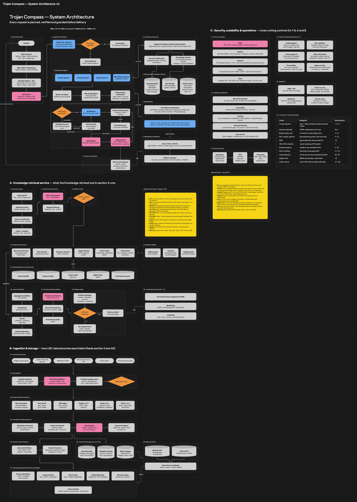

<a id="readme-top"></a>

<!-- PROJECT SHIELDS -->
[![Contributors][contributors-shield]][contributors-url]
[![Forks][forks-shield]][forks-url]
[![Stargazers][stars-shield]][stars-url]
[![Issues][issues-shield]][issues-url]
[![Apache License][license-shield]][license-url]

<!-- PROJECT LOGO -->
<br />
<div align="center">
  <a href="https://github.com/Siddharth-magesh/trojan-compass">
    
  </a>

<h3 align="center">Trojan Compass</h3>

  <p align="center">
    One conversation for everything a new USC student needs to figure out.
    <br />
    <a href="docs/PROJECT_DETAILS.md"><strong>Explore the docs »</strong></a>
    <br />
    <br />
    <a href="https://siddharth-magesh.github.io/trojan-compass/"><strong>Project website</strong></a>
    &middot;
    <a href="https://youtu.be/WsJGEmAON8k?si=k99srle5oakn7Qww"><strong>Watch the demo video</strong></a>
    &middot;
    <a href="docs/presentations/Trojan_Compass_Hackathon_Deck.pptx"><strong>View the hackathon deck</strong></a>
    &middot;
    <a href="#usage">See what you can ask</a>
    &middot;
    <a href="https://github.com/Siddharth-magesh/trojan-compass/issues/new?labels=bug">Report Bug</a>
    &middot;
    <a href="https://github.com/Siddharth-magesh/trojan-compass/issues/new?labels=enhancement">Request Feature</a>
  </p>
</div>

<!-- TABLE OF CONTENTS -->
<details>
  <summary>Table of Contents</summary>
  <ol>
    <li>
      <a href="#about-the-project">About The Project</a>
      <ul>
        <li><a href="#demo-video">Demo Video</a></li>
        <li><a href="#how-it-works">How It Works</a></li>
        <li><a href="#system-architecture">System Architecture</a></li>
        <li><a href="#data-and-retrieval">Data and Retrieval</a></li>
        <li><a href="#data-and-retrieval">Data and Retrieval</a></li>
      </ul>
    </li>
    <li>
      <a href="#getting-started">Getting Started</a>
      <ul>
        <li><a href="#prerequisites">Prerequisites</a></li>
        <li><a href="#installation">Installation</a></li>
      </ul>
    </li>
    <li><a href="#usage">Usage</a></li>
    <li><a href="#project-structure">Project Structure</a></li>
    <li><a href="#limitations">Limitations</a></li>
    <li><a href="#contributing">Contributing</a></li>
    <li><a href="#license">License</a></li>
    <li><a href="#contact">Contact</a></li>
    <li><a href="#acknowledgments">Acknowledgments</a></li>
  </ol>
</details>

<!-- ABOUT THE PROJECT -->
## About The Project

Starting at USC means juggling a dozen disconnected websites: the course catalogue, the schedule of classes, the career center, health and insurance portals, international student services and more. General-purpose chatbots do not reliably connect those sources to a student's situation. They can miss current USC rules, invent details, and provide answers without a traceable source.

**Trojan Compass** is a research assistant for incoming USC students. A student asks one question about courses, jobs, campus services, housing or pre-semester setup. A planner routes the request to domain specialists, the specialists use typed tools over local USC data and verified guides, and a verifier checks the result before the synthesizer returns one clear answer with citations.

Why it's different:
* **Source-grounded.** Answers use hand-collected, source-linked USC data rather than treating model memory as authoritative.
* **Personalized.** Synthetic demo profiles provide program, completed courses, budget and interests without using real student records.
* **Multi-domain.** One request can combine academics, careers, housing and student services.
* **Explicit about uncertainty.** Missing, stale or unavailable information is surfaced instead of being silently invented.
* **Observable.** The UI streams planning and specialist progress, then renders citations, cards and follow-up actions.

> An independent student project built for the AI USC Hackathon. Not an official USC service.

<p align="right">(<a href="#readme-top">back to top</a>)</p>

### Demo Video

[**Watch the demo on YouTube**](https://youtu.be/WsJGEmAON8k?si=k99srle5oakn7Qww). A local 1080p copy is also available at [docs/demo/trojan_compass_demo.mp4](docs/demo/trojan_compass_demo.mp4). The repository includes the production notes and Remotion source under [video/](video/).

The accompanying [hackathon presentation deck](docs/presentations/Trojan_Compass_Hackathon_Deck.pptx) summarizes the problem, product design, architecture and demo narrative.

<p align="right">(<a href="#readme-top">back to top</a>)</p>

### How It Works

1. **Authenticate the demo student.** The app uses mock JWT-style authentication and exposes only the selected synthetic profile.
2. **Understand and plan.** The supervisor classifies the request, selects domains and asks for clarification when the request is underspecified.
3. **Research in parallel.** Academic, housing, career and student-services agents use domain-specific allow-listed tools over structured JSON and retrieved guide content.
4. **Retrieve deterministically.** Retrieval combines local structured data with Pinecone-backed guide search, namespace-scoped by domain, with metadata filters and reranking where configured.
5. **Verify and recover.** The verifier checks facts, calculations, source coverage and freshness. A failed agent receives one targeted retry; a partial result is marked unverified rather than hidden.
6. **Synthesize and stream.** The synthesizer turns the verified package into a concise response while the API streams status, answer deltas, citations, cards and checklist data over SSE.
7. **Guard the boundary.** Input checks, tool schemas, authorization, rate limits, output checks and USC URL allow-listing operate in deterministic code around the model calls.

<p align="right">(<a href="#readme-top">back to top</a>)</p>

### System Architecture

Every request is planned, verified and guarded before delivery. The diagram covers:
- the request flow (user interface, LangGraph orchestration, controlled tools and the LLM gateway);
- the knowledge-retrieval service;
- ingestion and storage;
- cross-cutting security, scalability and operations.

[](docs/images/system_architecture.png)

<p align="right">(<a href="#readme-top">back to top</a>)</p>

### Data and Retrieval

The local database is the source of truth; Pinecone is a derived index for document retrieval. Structured records remain local and are queried by code. Documents and searchable records are normalized into chunks or vectors with source, domain, category, audience, academic year and verification metadata.

The current retrieval contract is:

* One Pinecone index named `trojan_compass`, using 384-dimensional BGE-small embeddings and cosine similarity.
* One namespace per domain (`academic`, `housing`, `career` and `student_services`).
* Hybrid retrieval followed by reranking, with top-k 20 reduced to 5 results for synthesis.
* Upserts in batches of 100; student profiles are never embedded.
* Ingestion scripts validate files, build changed chunks, update the index and remove stale vectors.

The data rules, schemas, registry and ingestion flow are documented in [docs/DATA_GUIDE.md](docs/DATA_GUIDE.md). The prototype includes course and class-section data, career and research resources, student-service guides and synthetic student profiles. Dataset counts and coverage are maintained in the registry and evaluation fixtures rather than duplicated here.

<p align="right">(<a href="#readme-top">back to top</a>)</p>

<!-- GETTING STARTED -->
## Getting Started

Run the AI backend and the chat app on your own computer in a few minutes.

### Prerequisites

* Python 3.11 or newer
* Node.js 22 or newer, plus pnpm
  ```sh
  npm install -g pnpm
  ```
* API keys: [Groq](https://console.groq.com/keys) for the primary model and [Pinecone](https://app.pinecone.io) for guide search. A [Gemini](https://aistudio.google.com/apikey) key is optional as a fallback.
* For an offline run, set `LLM_MODE=mock`; `LLM_MODE=cache` replays cached responses and calls live providers only on a cache miss.

### Installation

1. Clone the repo
   ```sh
   git clone https://github.com/Siddharth-magesh/trojan-compass.git
   cd trojan-compass
   ```
2. Copy the settings template and add your keys
   ```sh
   cp .env.example .env
   ```
3. Install and start the backend (the AI system) at http://localhost:8000
   ```sh
   python -m venv .venv
   .venv/bin/pip install -r backend/requirements.txt
   .venv/bin/uvicorn backend.main:app --port 8000
   ```
4. In a second terminal, install and start the chat app at http://127.0.0.1:5173
   ```sh
   cd frontend
   pnpm install
   pnpm dev
   ```
5. Optional: verify the local retrieval assets and Pinecone parity.
   ```sh
   cd local_database/scripts && python push_to_pinecone.py --verify-only
   ```

<p align="right">(<a href="#readme-top">back to top</a>)</p>

<!-- USAGE EXAMPLES -->
## Usage

Open **http://127.0.0.1:5173**, choose one of the synthetic demo students, and start asking:

* *"Can I take CSCI 104 and EE 250 next spring? Do the lectures clash?"*
* *"I'm on an F-1 visa. How many hours a week can I work on campus?"*
* *"Find me a part-time technical job on campus."*
* *"How do I pay my tuition from India?"*
* *"Which immunizations do I need before I arrive?"*
* *"Give me a pre-semester checklist."*
* All at once: *"I'm a new international student. Check two courses for spring, find a campus job, and give me a checklist."*

You get a short answer with citations, course schedule and prerequisite cards, job cards with pay and eligibility, USC service links, and an interactive checklist. When information is not in the verified data, the response says so rather than presenting a guess.

The browser UI can run against the FastAPI service or its in-browser mock API. The mock path is useful for demonstrations and does not require provider credentials. For the API contract, environment settings and current architecture decisions, see [docs/PROJECT_DETAILS.md](docs/PROJECT_DETAILS.md).

<p align="right">(<a href="#readme-top">back to top</a>)</p>

<!-- PROJECT STRUCTURE -->
## Project Structure

```text
frontend/          the chat app students use (React + Vite)
backend/           the AI system: planner, specialist agents, tools, checks and the API (FastAPI + LangGraph)
local_database/    collected USC data, registry, schemas and ingestion scripts
evaluation/        79 test questions and the search-quality evaluation
docs/              architecture details, data format, contribution rules, task list, demo media and architecture diagram
docs/presentations/ hackathon presentation decks
video/             how the demo video is made: Remotion scenes, recording scripts, claims and production docs
```

<p align="right">(<a href="#readme-top">back to top</a>)</p>

## Limitations

This is a hackathon prototype using synthetic student profiles and curated or replicated public USC information. It is not an official USC service, does not replace university advising or immigration advice, and must not be used as the sole basis for a time-sensitive academic, employment or visa decision. Housing data, live scraping, real student records and production identity management are outside the current scope.

The [docs/TASKS.md](docs/TASKS.md) file records project work separately from this overview.

<p align="right">(<a href="#readme-top">back to top</a>)</p>

<!-- CONTRIBUTING -->
## Contributing

Contributions make this project better. Read [docs/CONTRIBUTING.md](docs/CONTRIBUTING.md) and the rules in [docs/AGENTS.md](docs/AGENTS.md) first, then:

1. Create a branch (`git checkout -b feat/your_feature`)
2. Commit your changes (`git commit -m 'feat: add your feature'`)
3. Push the branch (`git push -u origin feat/your_feature`)
4. Open a Pull Request

### Top contributors:

<a href="https://github.com/Siddharth-magesh/trojan-compass/graphs/contributors">
  
</a>

<p align="right">(<a href="#readme-top">back to top</a>)</p>

<!-- LICENSE -->
## License

Distributed under the Apache License 2.0. See [LICENSE](LICENSE) for more information. Course, policy and service information belongs to the University of Southern California and is used here for a student demo only.

<p align="right">(<a href="#readme-top">back to top</a>)</p>

<!-- CONTACT -->
## Contact

* Siddharth Magesh: [@Siddharth-magesh](https://github.com/Siddharth-magesh)
* Harsh Sharma: [@Harsh-31](https://github.com/Harsh-31)
* Hamsashree Srivenkateswaran: [@hamsa224](https://github.com/hamsa224)
* [@pkathire-ai](https://github.com/pkathire-ai)

Project Link: [https://github.com/Siddharth-magesh/trojan-compass](https://github.com/Siddharth-magesh/trojan-compass)

<p align="right">(<a href="#readme-top">back to top</a>)</p>

<!-- ACKNOWLEDGMENTS -->
## Acknowledgments

* [USC Schedule of Classes](https://classes.usc.edu/) and [USC Catalogue](https://catalogue.usc.edu/), sources for course and program data
* [USC Office of International Services](https://ois.usc.edu/), [Student Financial Services](https://sfs.usc.edu/) and other public USC pages, sources for the guides
* [LangGraph](https://langchain-ai.github.io/langgraph/), the multi-agent orchestration
* [BAAI BGE](https://huggingface.co/BAAI/bge-small-en-v1.5), the embedding model
* [Replit](https://replit.com/), where the first version of the chat app was built
* [Best-README-Template](https://github.com/othneildrew/Best-README-Template), the template for this README
* [Shields.io](https://shields.io/) and [contrib.rocks](https://contrib.rocks/), the badges and contributor images

<p align="right">(<a href="#readme-top">back to top</a>)</p>

<!-- MARKDOWN LINKS & IMAGES -->
[contributors-shield]: https://img.shields.io/github/contributors/Siddharth-magesh/trojan-compass.svg?style=for-the-badge
[contributors-url]: https://github.com/Siddharth-magesh/trojan-compass/graphs/contributors
[forks-shield]: https://img.shields.io/github/forks/Siddharth-magesh/trojan-compass.svg?style=for-the-badge
[forks-url]: https://github.com/Siddharth-magesh/trojan-compass/network/members
[stars-shield]: https://img.shields.io/github/stars/Siddharth-magesh/trojan-compass.svg?style=for-the-badge
[stars-url]: https://github.com/Siddharth-magesh/trojan-compass/stargazers
[issues-shield]: https://img.shields.io/github/issues/Siddharth-magesh/trojan-compass.svg?style=for-the-badge
[issues-url]: https://github.com/Siddharth-magesh/trojan-compass/issues
[license-shield]: https://img.shields.io/github/license/Siddharth-magesh/trojan-compass.svg?style=for-the-badge
[license-url]: https://github.com/Siddharth-magesh/trojan-compass/blob/main/LICENSE
[React.js]: https://img.shields.io/badge/React-20232A?style=for-the-badge&logo=react&logoColor=61DAFB
[React-url]: https://react.dev/
[TypeScript]: https://img.shields.io/badge/TypeScript-3178C6?style=for-the-badge&logo=typescript&logoColor=white
[TypeScript-url]: https://www.typescriptlang.org/
[Vite]: https://img.shields.io/badge/Vite-646CFF?style=for-the-badge&logo=vite&logoColor=white
[Vite-url]: https://vite.dev/
[Tailwind]: https://img.shields.io/badge/Tailwind_CSS-06B6D4?style=for-the-badge&logo=tailwindcss&logoColor=white
[Tailwind-url]: https://tailwindcss.com/
[Python]: https://img.shields.io/badge/Python-3776AB?style=for-the-badge&logo=python&logoColor=white
[Python-url]: https://www.python.org/
[FastAPI]: https://img.shields.io/badge/FastAPI-009688?style=for-the-badge&logo=fastapi&logoColor=white
[FastAPI-url]: https://fastapi.tiangolo.com/
[LangGraph]: https://img.shields.io/badge/LangGraph-1C3C3C?style=for-the-badge&logo=langchain&logoColor=white
[LangGraph-url]: https://langchain-ai.github.io/langgraph/
[Pydantic]: https://img.shields.io/badge/Pydantic-E92063?style=for-the-badge&logo=pydantic&logoColor=white
[Pydantic-url]: https://docs.pydantic.dev/
[Groq]: https://img.shields.io/badge/Groq-F55036?style=for-the-badge&logoColor=white
[Groq-url]: https://groq.com/
[Gemini]: https://img.shields.io/badge/Google_Gemini-8E75B2?style=for-the-badge&logo=googlegemini&logoColor=white
[Gemini-url]: https://ai.google.dev/
[Pinecone]: https://img.shields.io/badge/Pinecone-000000?style=for-the-badge&logoColor=white
[Pinecone-url]: https://www.pinecone.io/
